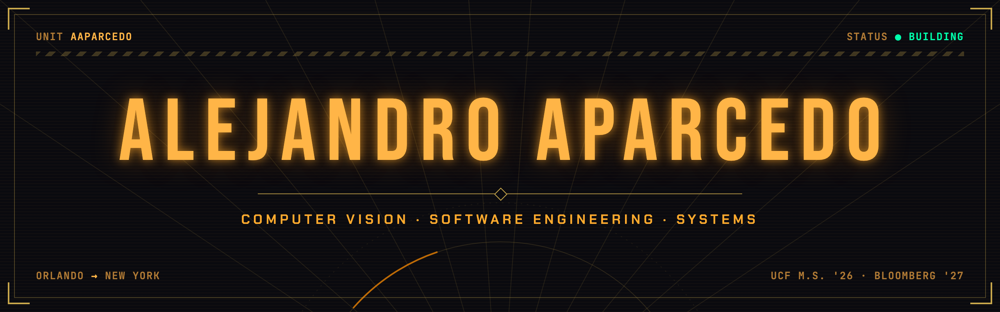

Software engineer with a background in computer vision research. I like building things end to end.

Joining Bloomberg in New York in February 2027. Finishing an M.S. in Computer Vision at UCF (December 2026), with research at the Center for Research in Computer Vision. NSF GRFP Fellow. Before that, supercomputing at Los Alamos National Laboratory.

### Elsewhere

[alejandroaparcedo.com](https://alejandroaparcedo.com) · [Google Scholar](https://scholar.google.com/citations?user=Vf-MwHEAAAAJ&hl=en) · [LinkedIn](https://www.linkedin.com/in/alejandro-aparcedo)
